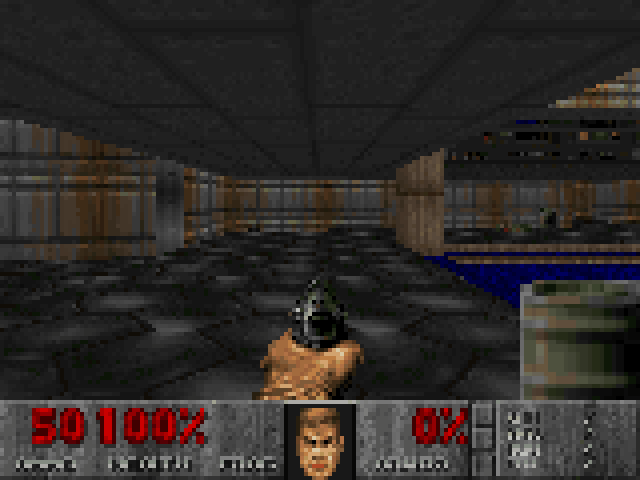
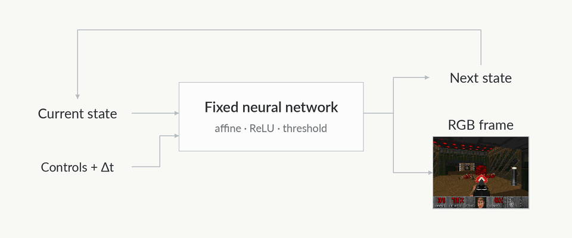

# Doomnet

Humanity’s greatest virtue is its insistence on making everything run Doom.

We’re carrying that tradition forward: **we made DOOM run inside a neural network.**

Doomnet recreates Doom's original **E1M1: Hangar** as a fixed recurrent neural
network. You control the player. The network computes the world.

Walk the corridors, open doors, collect armor, and fight your way to the exit.
Every game update and finished RGB frame comes from fixed affine transformations,
ReLU, and hard threshold neurons. The map, artwork, and rules become weights and
wiring—even arithmetic and texture lookups are built from those same primitives.

There is no training phase. The network is constructed explicitly, then played.



*Gameplay excerpts, with pauses shortened.
[Watch the two-minute preview](docs/media/live-play.webp).*

## The engine is the network

One pass takes the current state, your controls, and a tick duration. It returns
the next state and a completed image. Feed that state back in, press another key,
and the world moves forward.

The recurrent state holds the player, enemies, projectiles, doors, moving floors,
and the rest of the changing world in **2,456 activations**. Fixed connections
compute collisions, attacks, visibility, artwork addressing, and the pixels of
the weapon and status bar. Original WAD data and explicitly written rules are
the construction inputs.



*The next state feeds back into the fixed network for the following step.*

The runtime supplies keyboard input and timing, carries the returned state, and
puts the finished pixels on screen.

## Play the Hangar

The supported game is **Doom shareware 1.9, E1M1, Hurt Me Plenty, at 160 × 120**.
Both a native window and a local browser accept live controls.

- Explore the original map: corridors, stairs, outdoor areas, and all three
  secrets, with original textures, sprites, weapons, and HUD artwork.
- Fight zombies and imps with the fist, pistol, and shotgun. Enemies pursue and
  attack; fireballs and exploding barrels change the outcome.
- Pick up ammunition, health, and armor. Open doors, trigger moving floors, ride
  the lift, and use the level's exit switch.
- Die, restart, and take a different route. The next world state is computed
  from what you do.

Doomnet uses simplified movement, combat, and rendering rules built specifically
for this level.

## Run it

Use Python 3.11 or later and a PyTorch build for your CUDA or ROCm accelerator;
`--device cuda` selects either. On an RX 7900 GRE, live browser play generally
displayed **16–17 frames/s**. The simulation clock runs at **35 ticks/s**, with
multiple state updates between presented frames.

```sh
python -m pip install -e .
python scripts/fetch_shareware.py
export TORCHINDUCTOR_CACHE_DIR="$PWD/build/inductor-cache"
export TRITON_CACHE_DIR="$PWD/build/triton-cache"
python -m doomnet build --wad assets/doom1.wad --out build/full-neural-e1m1-support --device cuda --threads 1
python -m doomnet serve --model build/full-neural-e1m1-support --device cuda --threads 1
```

Open [localhost:8765](http://127.0.0.1:8765), press **Start**, and play. GPU
preparation can take many minutes on first use; startup with retained caches
still took about four minutes on that setup. CPU execution is available with
`--device cpu --threads 4` for both build and play, but measured about 19 seconds
per frame on a Ryzen 9 7900.

For the native window, replace the last command with:

```sh
python -m doomnet play --model build/full-neural-e1m1-support --device cuda --threads 1 --scale 4
```

| Control | Action |
| --- | --- |
| W / S | Forward / backward |
| A / D | Strafe left / right |
| Left / Right arrows | Turn |
| Shift | Run |
| Space / left mouse button | Fire |
| E | Use a door or switch |
| 1 / 2 / 3 | Fist / pistol / shotgun, once acquired |
| R | Restart |
| P | Pause |
| Escape | Exit native play; pause in the browser |

Add `--mouse` for native mouse look, or enable it in the browser. Browser buttons
also accept pointer and touch input.

## Open the engine

Each build includes circuit descriptions, primitive operation graphs, and an
audit of every exported method. Inspect the saved network with:

```sh
python -m doomnet inspect --model build/full-neural-e1m1-support
python -m doomnet inspect --model build/full-neural-e1m1-support --graph > build/graph.txt
```

## Credits

Original Doom artwork and level data are by **id Software**. Doomnet is an
original Python/tensor implementation; research used id Software's published
[Doom source](https://github.com/id-Software/DOOM/tree/master/linuxdoom-1.10).
The fetch script obtains the unmodified shareware WAD from a
[pinned shareware collection revision](https://github.com/Doom-Utils/shareware-collection/tree/6591a922701e5769b32278e9c555b1bf93f5714c/Doom%201.9),
which includes the original distribution terms.
